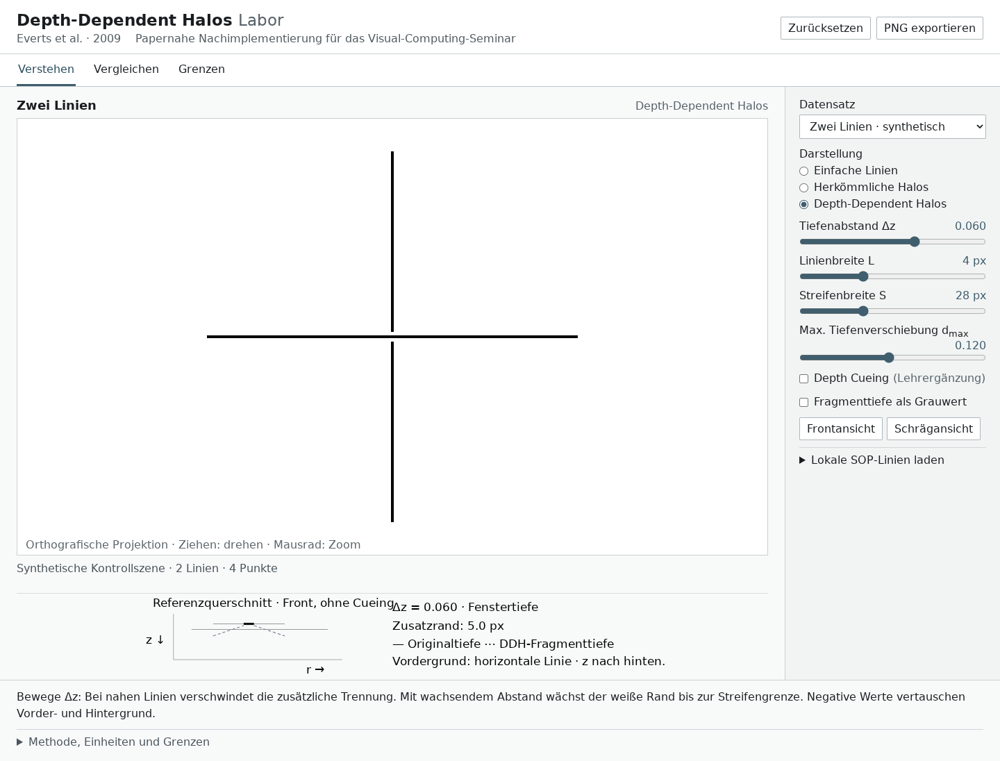
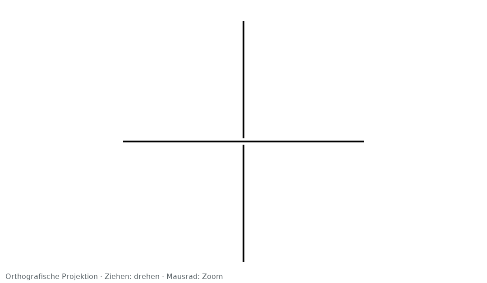
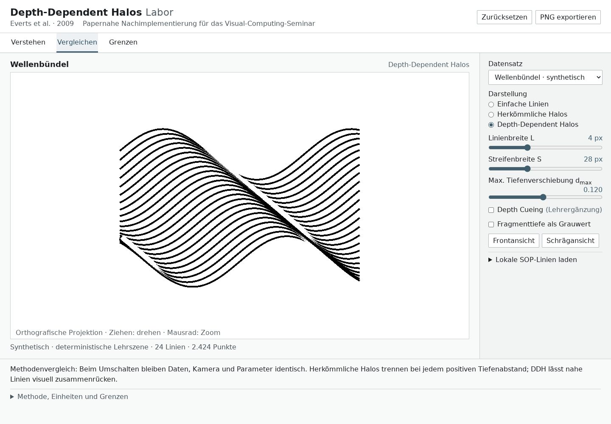
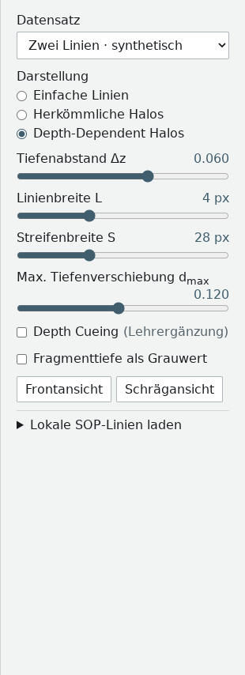

# DDH-Lab — Interactive Depth-Dependent Halos

**Explore how depth-buffer manipulation turns simple black lines into readable 3D illustrations.**

A browser-based Visual Computing teaching lab built with **TypeScript, WebGL2,
and Vite**. Compare plain lines, traditional halos, and depth-dependent halos
using controlled synthetic scenes and optional, locally downloaded research data.



[Quick start](#getting-started) · [The method](#how-depth-dependent-halos-work) ·
[Mathematics](#mathematical-foundations) · [Screenshots](#screenshots-and-demonstrations) ·
[Validation](#testing-and-validation) · [References](#scientific-background-and-references)

## Overview and Motivation

Dense line drawings can hide spatial relationships: when everything is black,
which line is in front? A white halo separates a foreground line from its
background, but fixed halos can also break up closely packed bundles.

DDH-Lab makes this trade-off interactive. Change depth separation and watch
the additional white gap disappear for nearby lines, grow with separation, and
reach a fixed maximum. The original research is by **Everts et al. (2009)**.
This is an independent educational implementation, not the authors' software;
it is not presented as endorsed or maintained by them.

The application interface is currently **German**. The controls below include
their on-screen labels; supporting research and validation notes are also German.

## Features and Interactive Controls

- **Three rendering modes:** plain lines, traditional constant halos, and DDH.
  Method switching preserves the dataset, camera, and shared parameters.
- **Three teaching presets:** Understand (*Verstehen*), Compare (*Vergleichen*),
  and Limits (*Grenzen*). Selecting a preset resets its parameters and camera.
- **Synthetic scenes:** two intersecting lines, a deterministic wave bundle,
  and a bundle with hidden background structure.
- **Inspectable parameters:** widths, depth separation/displacement, independent
  depth cueing, and fragment-depth grayscale diagnostics.
- **Front/oblique views**, pointer and keyboard camera control, and global reset.
- **PNG export** of the current canvas without surrounding controls.
- **Local SOP import** with format and size validation. Optional original presets
  include two knots, office airflow, and fiber tracts after local preparation.
- **Local operation:** no CDN or external runtime service after setup.

| Control | On-screen label | Effect |
| --- | --- | --- |
| Depth separation Δz | Tiefenabstand Δz | Changes two-line geometry; positive puts horizontal in front **in Front view**, negative swaps roles |
| Black width L | Linienbreite L | Full black width before cueing, in framebuffer pixels |
| Strip width S | Streifenbreite S | Full line-plus-halo width, in framebuffer pixels |
| Maximum displacement | Max. Tiefenverschiebung dmax | Maximum backward displacement of white DDH fragments in window depth |
| Depth cueing | Depth Cueing | Educational extension varying black width with depth |
| Depth diagnostic | Fragmenttiefe als Grauwert | Displaced fragment depth as grayscale: darker is nearer |
| Camera/reset | Frontansicht / Schrägansicht / Zurücksetzen | Front view, oblique view, or complete reset |

Drag to rotate; use the mouse wheel to zoom. With the canvas focused, arrow keys
rotate and `+` / `-` zoom. Camera rotation can reverse depth ordering even when
the cross still looks horizontal/vertical. Use **Frontansicht** before interpreting
Δz as the current depth difference. The side panel limits its numerical reference
to Front view without cueing. Widths use framebuffer pixels, not CSS pixels.

## How Depth-Dependent Halos Work

The lab uses one rendering pass:

1. **Build view-aligned strips.** Each segment becomes two triangles. The vertex
   shader widens it perpendicular to its projected direction, keeping its center
   on the input line. Adjacent segments use bounded miter joins.
2. **Classify fragments.** A central band is black; the remaining strip is white.
   `L` controls full black width and `S` full strip width, with `0 < L < S`.
3. **Displace white depth.** Black fragments retain their depth. White DDH
   fragments receive increasing backward displacement toward the strip edge.
4. **Resolve visibility.** Depth testing uses `LESS` with depth writes enabled.
   Foreground white hides background black only while its displaced depth is
   still nearer, creating a white gap that depends on separation.

This changes fragment depth, not the input geometry. A background halo cannot
erase a genuinely nearer black line under this rule. Traditional halos use the
black/white strip without displacement; plain-line mode draws a narrow black strip.

The core follows the [paper](https://tobias.isenberg.cc/personal/papers/Everts_2009_DDH.pdf),
§§3.2–3.3, Eqs. 1–3 and Figure 3. Orthographic projection, pixel widths,
analytic classification, bounded joins, and bounded cueing are lab choices.

## Mathematical Foundations

These equations describe the implemented straight-strip kernel **without cueing**.
For signed perpendicular distance `r` from the centerline in framebuffer pixels,
the normalized transverse distance is

$$q = \frac{2|r|}{S}, \qquad 0 \le q \le 1.$$

A fragment is black when

$$|r| \le \frac{L}{2} \quad\Longleftrightarrow\quad q \le \frac{L}{S}.$$

DDH uses the linear profile

$$
z' = \begin{cases}
z, & \text{black fragment},\\
z + d_{\max}q, & \text{white fragment}.
\end{cases}
$$

Depth values and `dmax` are **dimensionless window/depth-buffer coordinates**,
not metric world distances. Larger values are farther away. The lab projects
rotated geometry orthographically using

$$z_{\mathrm{window}} = \frac{1}{2} + \frac{z_{\mathrm{rotated}}}{4}.$$

For two straight perpendicular lines in Front view, let
$\delta=z_{\mathrm{back}}-z_{\mathrm{front}}\ge0$.
Foreground white occludes background black when

$$z_{\mathrm{front}} + \frac{2|r|d_{\max}}{S} < z_{\mathrm{back}}.$$

Combining visibility with the white-fragment domain gives the **additional
one-sided white gap beyond the black edge**:

$$
h = \max\!\left(0,\;\min\!\left(\frac{S}{2},\frac{S\delta}{2d_{\max}}\right)-\frac{L}{2}\right),
\qquad d_{\max}>0.
$$

This is the project's independent visibility derivation, implemented in
[`src/model.ts`](src/model.ts), rather than a literal copy of the paper's Appendix
equation. It assumes fixed widths, Front view, no cueing, and excludes individual
raster/depth ties. Figures 3 and 18 provide the reference construction.
[RESEARCH.md](docs/RESEARCH.md) documents observed inconsistencies in the printed
width relation and Appendix signs; these are not an author-issued erratum.

With defaults `L=4 px`, `S=28 px`, `dmax=0.12`:

| Depth separation δ | Derived extra gap h | Meaning |
| --- | ---: | --- |
| 0.001 | 0 px | No additional white separation |
| 0.060 | 5 px | Intermediate depth-dependent halo |
| 0.200 | 12 px | Saturated at the strip boundary |

The gap starts above $\delta=d_{\max}L/S$ and saturates at
$\delta=d_{\max}$. At fixed separation, increasing `dmax` can **reduce** the gap.
The white-depth ramp does not restart at zero at the black edge. Traditional
halos use zero displacement, yielding `(S−L)/2` for positive separation.
Exact equality remains a separate tie case under `LESS`.

## Screenshots and Demonstrations

All images are real browser captures of this application using **synthetic data**,
not paper figures or historical-demo images.
[Capture settings and provenance](docs/images/README.md).

### Two lines: intermediate separation



Front view, DDH, `L=4`, `S=28`, `dmax=0.12`, `Δz=0.06`; cueing off.

### Changing depth separation

| Nearby: Δz = 0.001 | Farther apart: Δz = 0.200 |
| --- | --- |
|  |  |

Only Δz changes from the two-line settings above.

### Line bundle



### Parameter controls



### A two-minute walkthrough

1. In **Verstehen**, try Δz `0.001`, `0.060`, then `0.200` to see gap growth and
   saturation. Use a negative value to swap foreground/background.
2. Select **Vergleichen**. Switch plain lines → traditional halos → DDH with a
   fixed camera. Toggle cueing separately.
3. Select **Grenzen**, inspect hidden structure, then choose **Schrägansicht**.
   Try **Exakt gleiche Tiefe** to examine the absence of a unique depth ordering.
4. Export a PNG; **Zurücksetzen** restores the initial scene and parameters.

## Getting Started

### Requirements

- **Node.js 24** and npm; tested with Node 24.21.0 / npm 11.19.0.
- A **WebGL2** browser.
- **Python 3.10+**, only for optional reference/data preparation.

### Run the synthetic lab

From your cloned repository directory:

```bash
npm ci
npm run dev -- --port 4178 --strictPort
```

Open **http://127.0.0.1:4178**. Stop with `Ctrl+C`. Python and research downloads
are unnecessary for synthetic scenes. A fresh clone displays a notice that
optional original datasets have not been prepared.

### Optional: prepare original datasets locally

```bash
python3 scripts/fetch_references.py --extract
python3 scripts/inspect_references.py
python3 scripts/prepare_data.py
```

These scripts download pinned public references, verify size/SHA-256, safely
extract archives, and prepare four complete original line datasets under
`public/data/local/`. They do not run upstream programs. Original files and
acknowledgements remain intact. Downloads and prepared data are **gitignored
and absent from a fresh clone**.

The browser validates preset hashes, counts, and bounds before centering and
uniformly scaling coordinates. The fiber data differs from the paper's dataset;
its extra scalar attribute is validated but not interpreted. For private imports,
choose the declared type from the source `description.ini`: the supported SOP
header does not distinguish lines from points. Point rendering is rejected.
Import limits: 64 MiB, 600,000 points, 100,000 sequences; renderer limit:
600,000 segments.

After dependencies and desired data are installed, local use needs no Internet.
Offline npm reinstallation requires a previously populated cache; the repository
does not supply one.

### Production build and local preview

```bash
npm run build
npm run preview -- --port 4178 --strictPort
```

Open the same URL. `/probe.html` is the minimal rendering test surface. Use HTTP,
not `file://`.

**Build contents:** Vite copies `public/` into `dist/`, including locally prepared
original data. Review redistribution rights before sharing that build; ignoring
data in Git does not exclude it from a build. A fresh clone without prepared data
produces a synthetic-only build. Current root-relative URLs assume root hosting;
GitHub Pages repository-subpath hosting requires additional base-path work.
No hosted live demo is claimed here.

## Testing and Validation

```bash
npm test
npm run build
```

Node tests cover visibility, scene-depth mapping, normalization, and SOP integrity
and limits. Original-data cases explicitly skip when local sources are absent;
skips do not demonstrate successful data validation.

For browser checks, install Playwright Chromium, ensure its OS libraries are
available, and stop any server occupying port 4178:

```bash
npx playwright install chromium
# Synthetic rendering checks, without research downloads:
npm run test:gpu -- tests/browser/core.spec.ts
```

After optional references and data are prepared, run the complete suite:

```bash
npm run test:gpu
npm run build
npm run test:production
```

The full suite requires that preparation for original-data loading/import and an
adapted original-shader comparison. Browser tests start their own server on 4178
and do not reuse an existing one. Generated captures go to `.artifacts/`.
`DDH_CHROMIUM=/absolute/path/to/chromium` selects an existing browser.
If 4178 is occupied, choose a free port, for example
`DDH_PORT=4190 npm run test:production` (POSIX shell syntax).

On the minimal Ubuntu development VM, the optional
`python3 scripts/setup_browser_libs.py` unpacks missing browser libraries and a
test font into `.cache/` using existing APT metadata. It needs no sudo and changes
no system packages or global configuration. Other systems with working Chromium
do not need this VM-specific helper.

Documented graphics checks use Chromium 156.0.8078.4 with ANGLE/SwiftShader
**software rendering**. They verify analytical pixel transitions, depth changes,
data integrity, and interaction; they establish neither hardware-GPU compatibility
nor perceptual superiority. [VALIDATION.md](docs/VALIDATION.md) records evidence
and remaining presentation-device checks.

## Project Structure

```text
src/
  renderer.ts          WebGL2 setup, strip geometry, vertex/fragment shaders
  model.ts             Scenes, parameters, halo-width derivation
  main.ts              State, controls, loading, camera, PNG export
  ui.ts / style.css    German interface and styling
  sop.ts               Validating SOP v0 line-data reader
  probe.ts             Minimal renderer test surface
tests/                 Node and browser checks
scripts/               Reference downloads and local data/browser setup
references/            Pinned sources and dataset inventory
docs/
  images/              Actual application screenshots and capture settings
  RESEARCH.md          Sources, conventions, independent derivations
  VALIDATION.md        Criteria, results, limitations
  DESIGN.md            Interface and demo design
  PLAN.md              Milestones and current status
```

Rendering uses WebGL2 directly; there is no UI framework or Three.js dependency.
TypeScript, Vite, and Playwright versions are pinned by the lockfile.

## Scientific Background and References

**Maarten H. Everts, Henk Bekker, Jos B. T. M. Roerdink, and Tobias Isenberg (2009).**
*Depth-Dependent Halos: Illustrative Rendering of Dense Line Data.*
IEEE Transactions on Visualization and Computer Graphics, **15**(6), 1299–1306.
[DOI: 10.1109/TVCG.2009.138](https://doi.org/10.1109/TVCG.2009.138).

- [Original paper](https://tobias.isenberg.cc/personal/papers/Everts_2009_DDH.pdf):
  §§3.2–3.3, Figures 3/18, and Appendix A underpin the discussion.
- [Authors' project page](https://tobias.isenberg.cc/VideosAndDemos/Everts2009DDH):
  research, original demo, videos, and supplementary materials.
- [Pinned manifest](references/sources.json): download URLs, sizes, and hashes.
- [Research notes](docs/RESEARCH.md): original shader correspondence, provenance,
  conventions, and interpretation of printed inconsistencies.

The broader technique also addresses points; **this lab implements lines only**.
Its validation does not reproduce the paper's evaluation.

### Rights and attribution

No project license has been selected or added. Third-party papers, programs,
shaders, textures, and datasets are downloaded separately and retain their own
rights and acknowledgements. The project page's license for specific example
images is not a blanket code/data license. Repository screenshots use only this
application's synthetic scenes.

## Limitations and Future Improvements

- **Adaptation:** orthographic projection, fixed pixel widths, analytical profile,
  flat ends, bounded miters, and custom cueing; no historical-demo pixel identity.
- **Raster/geometry:** no antialiasing; sharp turns and nearly view-parallel
  segments remain difficult. Cueing may expand black width up to strip width.
- **Depth:** depth is not metric; equality/raster boundaries can have precision
  and submission-order ties. Halos cannot reveal fully hidden geometry.
- **Scope:** no point-cloud renderer, stereo, or scientific filtering. Water flow
  is a parser check, not an application preset.
- **Environment:** a manual presentation-browser/driver/projector demo, resize,
  and export check remains necessary beyond software-rendered tests.

Future directions include English UI text, subpath-safe hosting, more hardware
browser coverage, improved joins/ends, and a separately specified perspective
mode. These are possibilities, not implemented features.
